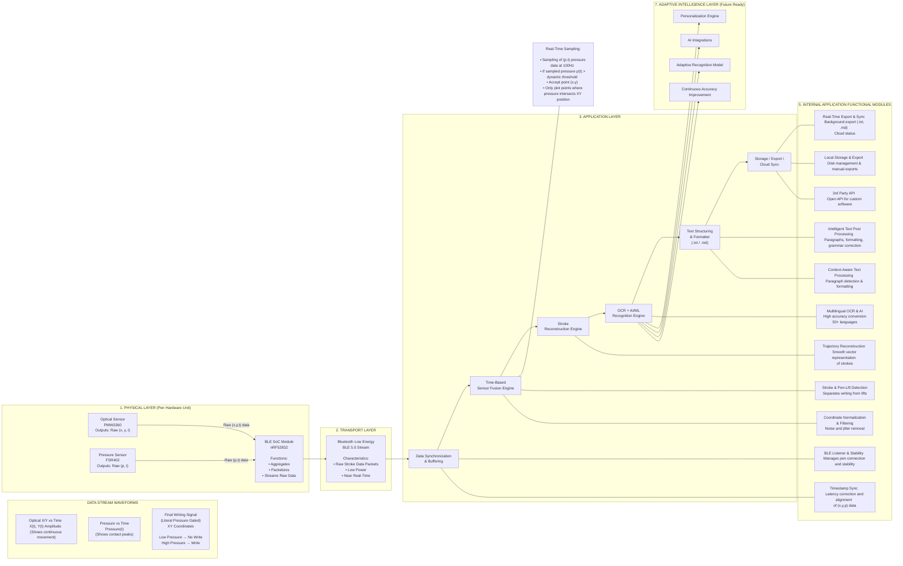

FUTURE ENHANCEMENTS
Personalized Writing Intelligence - Build a user-specific language and style model
that learns vocabulary, phrasing, and stroke patterns over time, enabling AI-
generated text that closely mimics the user’s natural writing style.
Context-Aware Content Generation - Automatically transform handwritten notes
into structured outputs such as blogs, emails, summaries, or documentation based on
detected writing intent—without requiring manual editing on a phone or PC.
AI assisted writing - A separate gesture for to active AI input to resolve written
mistakes, AI content continuation, utilizing AI tools and more AI functionalities.
Semantic understanding with smart organization and cross-device recall,
enabling handwritten content to be semantically tagged, clustered, searchable, and
contextually accessible across devices and applications with optional cloud sync.
FUNCTIONAL ARCHITECTURE:
# Functional Architecture

----
LIST OF MODULES
Pen Module:
- optical sensor (PMW3360)
- pressure sensor (FSR402)
- SOC (Tiny nRF52832)
Transport Layer:
- Bluetooth
- internal flash memory 5mb (offline capability)
Application Layer:
- Mobile or PC running a software application
Cloud
- Cloud for syncing data between devices
- Serverless database for storing
Software and tools
Pen Module:
- Embedded C collecting sensor data
- Transmission layer logic
Application Layer:
- React-native cross platform mobile application
- Electron cross platform for desktop application
- Core Application login in native languages(Kotlin,C++,Shift)
- Large Language Models for processing mistakes in handwriting
- CNN & RNN (LSTMs/RNNs) ML for ETL pipeline converting handwriting to text
Cloud
- Edge function in cloudflare workers
- Neon S3 compatible content lake for various purposes
