SCRIPTOR - A TRUE DIGITAL PEN
Presented By :
Santhosh MK - 311622244022
Navaneetha Krishnan G - 311622244016
Naveen Srinivas E - 311622244017
Supervised By :
Mrs. Subbasri N P, Assistant
Professor CSBS DEPTMENT
OBJECTIVE
To design and develop a surface-agnostic digital pen that captures handwriting on any
paper-based surface and converts it to editable digital formats (.txt, .md) with
 ≥ 90%
character recognition accuracy.
The system integrates,
Optical sensors motion tracking,
Edge AI/ML for real-time handwriting recognition, and
Bluetooth Low Energy (BLE) for seamless data transmission to a cross-platform
mobile/desktop application.
This addresses the limitation of existing smart pens that require proprietary paper/
surfaces, reducing user friction and hardware cost by an estimated 60%.
ABSTRACT
SCRIPTOR – a surface-agnostic true digital pen designed to capture handwriting on
any paper-based surface and convert it into editable digital text formats.
Unlike existing smart pens that rely on proprietary dotted paper, fixed reference
surfaces, or external infrastructure, our solution operates independently of surface
type, orientation, or environment.
The proposed system captures fine-grained pen optical and writing intent through
combined motion and well-placed pressure sensing, generating raw stroke data.
The captured data is transmitted wirelessly to a remote mobile or desktop
application, where preprocessing, handwriting recognition, and text formatting
are performed using AI/ML-based optical character recognition techniques.
The final output is delivered in editable formats such as .txt and .md, ensuring a
seamless, cross-platform workflow that maintains the natural feel of handwriting.
EXISTING SYSTEM & ITS LIMITATIONS
Technology
 How It Works
 Key Limitations
Uses onboard cameras to track pen
 Requires proprietary dotted/special
Camera-based Digital Pen
 movement on patterned surfaces.
 paper; fails on blank surfaces.
Accelerometer-based
 Captures pen motion data using
 Low accuracy, cumulative drift,
Digital Pen
 inertial sensors.
 poor handwriting precision.
Combines sensor data like camera + Complex hardware, increased cost,
Hybrid Digital Pen
 accelerometer for tracking
 multiple-calibration issues; fragile.
Tracks pen position using infrared
 Requires external reference points,
Infrared Digital Pen
 emitters and receivers.
 limited range, surface dependant
Needs external receiver setup;
Triangulates pen position using
Ultrasonic Digital Pen
 Affected by noise and reflections,
ultrasonic receivers
accuracy drops over time.
Never shipped reliably; accuracy
Phree by OTM
 A commercial attempt at a surface-
 degraded rapidly; no page
Technologies
 agnostic digital pen and air mouse.
 awareness; their 3D co-ords. broke
easily.
PROPOSED SYSTEM
A surface-agnostic true digital pen that captures handwriting on any paper-based
surface and converts it to editable digital formats (.txt, .md) with
 ≥90% character
recognition accuracy which can be access by remote device(Mobile phones/PC)
seamlessly without any additional device dependency.
Unlike existing smart pens that rely on proprietary paper, fixed reference
surfaces, or external infrastructure, this system operates independently of surface
type, orientation, or environment, significantly reducing cost and usability constraints.
This digital pen integrates optical motion tracking sensors to capture fine-grained
pen movement and a well placed button-like pressure sensor for tracking pen
movement coordinates on paper/intended surface
The raw data from both sensors is processed by a specialized application uses OCR
and AI/ML in remote devices via bluetooth for the digital conversion
PROPOSED SYSTEM
This approach minimizes latency, preserves user privacy, and ensures a seamless writing-
to-digital workflow, making it a practical and scalable alternative to current digital pen
technologies.
Surface-agnostic optical tracking using an ADNS-9800 sensor, indirect pressure
detection via a mechanically coupled FSR402, raw data streaming with zero on-device AI,
and direct BLE connectivity to phones or laptops without any dedicated receiver or pad.
Existing Limitation
 Our Solution
Proprietary paper required
 Optical motion tracking works on any surface texture
Sensor fusion eliminates drift; optical provides absolute
Accuracy degrades over time
reference
Edge AI detects page boundaries via stroke clustering + lift-
No page awareness
off detection
Poor handwriting fidelity
 High-DPI optical sensor preserves stroke dynamics
External hardware clutter
 Self-contained pen + BLE to existing devices
AUTHOR
Wehbi et al.
Li et al.
LITERATURE SURVEY
TITLE (YEAR)
 METHODOLOGY
 FINDINGS
Demonstrated practical
Digitizing Handwriting with Sensor-equipped pen with IMU real-time writer-
a Sensor Pen: A Writer-
 + CNN for real-time
 independent recognition
Independent Recognizer
 handwriting recognition on
 using sensor data streams;
(2021)
 normal paper
 effective without special
surfaces.
Robust and Efficient
Writer-Independent IMU-
Based Handwriting
Recognization (2025)
Encoder-decoder IMU data
model with CNN + BiLSTM for
WI handwriting recognition
Shows improved
robustness and efficiency
across unseen writers; high
accuracy across varied
conditions.
AUTHOR
Alemayoh et al.
LITERATURE SURVEY
TITLE (YEAR)
 METHODOLOGY
 FINDINGS
Deep-Learning-Based
Character Recognition
from Handwriting Motion
Data (2022)
Compact smart pen with IMU +
force sensors; ViT/CNN/LSTM
for character recognition
Achieved high recognition
accuracy (~99%) using
combined inertial + force
data on regular paper.
Imbert et al.
Mixture-of-Experts for
Handwriting Trajectory
Reconstruction (2025)
MOE learning for precise
trajectory reconstruction in
digital pen systems
Enhanced trajectory
reconstruction for digital
handwriting trace while
writing on surfaces.
AUTHOR
Schrapel et al.
Singh & Chaturvedi
LITERATURE SURVEY
TITLE (YEAR)
 METHODOLOGY
 FINDINGS
Pentelligence: Combining PenTip Motion and Writing Sounds(2018)
Multi-modal sensor fusion
Sensor fusion of
 (motion + audio) improves
accelerometer/gyroscope (motion) recognition accuracy over
+ microphone (writing sounds) for
 single-modality; demonstrates
handwritten digit recognition; edge- feasibility of low-complexity
compatible lightweight processing sensor combinations for digit
recognition
Multi-Modal Sensors Feature
Fusion for Handwritten
Characters Recognition (2024)Shapley values + deep autoencoderfor optimal feature fusion from
multiple wearable sensors; sensor
selection based on contribution
importance
Proposed feature fusion
approach achieves superior
recognition accuracy by
intelligently weighting sensor
contributions; validates sensor
fusion over single-sensor
dependency
FUTURE ENHANCEMENTS
Personalized Writing Intelligence - Build a user-specific language and style model
that learns vocabulary, phrasing, and stroke patterns over time, enabling AI-
generated text that closely mimics the user’s natural writing style.
Context-Aware Content Generation - Automatically transform handwritten notes
into structured outputs such as blogs, emails, summaries, or documentation based on
detected writing intent—without requiring manual editing on a phone or PC.
Self-Improving Handwriting Recognition - Apply reinforcement learning and
continuous feedback loops to adapt recognition models to individual handwriting
styles, improving accuracy with long-term usage.
Semantic understanding with smart organization and cross-device recall,
enabling handwritten content to be semantically tagged, clustered, searchable, and
contextually accessible across devices and applications with optional cloud sync.
SYSTEM ARCHITECTURE:

# System Architecture

```mermaid
flowchart LR

%% ==============================
%% PHYSICAL LAYER
%% ==============================

subgraph Physical["PHYSICAL LAYER (Pen Hardware)"]

PS1["OPTICAL SENSOR  
(PMW3360)"]

PS2["PRESSURE SENSOR  
(FSR402)"]

BLE["BLE SoC MODULE  
(nRF52832)"]

NoteP["Captures X,Y coordinates  
and Pressure values"]

PS1 --> BLE
PS2 --> BLE

BLE --- NoteP

end


%% ==============================
%% TRANSPORT LAYER
%% ==============================

subgraph Transport["TRANSPORT LAYER (Wireless Communication)"]

BLEPROT["Bluetooth Low Energy  
(BLE) 5.0 (2.4 GHz)"]

TX["Transmit Raw Stroke  
Data Packets"]

OPTSTREAM["Optical Data Stream  
(X, Y, Time)"]

PRESSSTREAM["Pressure Data Stream  
(Pressure, Time)"]

MERGE["DATA MERGE  
'WRITING PROCESS'

Match data by TIME (t)

Keep Optical Data (X,Y)
only when Pressure
is detected"]

FORMAT["Data Formats

optical_sensor_data =
array[(x,y,t)]

pressure_sensor_data =
array[(p,t)]"]

OPTSTREAM --> MERGE
PRESSSTREAM --> MERGE

MERGE --> FORMAT

end


%% ==============================
%% APPLICATION LAYER
%% ==============================

subgraph Application["APPLICATION LAYER  
Remote Device (Mobile/Desktop App)"]

APP1["1. DATA PREPROCESSING

Noise Filtering  
Time Synchronization"]

APP2["2. OCR + AI/ML ENGINE

Handwriting Recognition  
Stroke-to-Text Conversion"]

APP3["3. TEXT FORMATTER

Output Formats:
txt
md"]

APP4["4. STORAGE / EXPORT / SHARING

Local Storage  
File Export  
Sharing Options"]

APP1 --> APP2
APP2 --> APP3
APP3 --> APP4

end


%% ==============================
%% CLOUD SYNC MODULE
%% ==============================

subgraph Cloud["CLOUD SYNC MODULE (Optional)"]

CPURPOSE["Purpose

Cross-platform synchronization"]

CIMPL["Implementation

Custom Cloud API"]

end


%% ==============================
%% EXAMPLE MERGED DATA FORMAT
%% ==============================

subgraph Example["Example Merged Data Format"]

E1["optical_sensor_data

[(x5,y5,t5),
(x6,y6,t6)...]"]

E2["pressure_sensor_data

[(p1,t5),
(p2,t6),
(p3,t7)...]"]

E3["Final Output  
(Merged based on t)

[(x5,y5,p1),
(x6,y6,p2),
(x7,y7,p3)...]"]

end


%% ==============================
%% CONNECTIONS
%% ==============================

BLE --> TX
TX --> BLEPROT
BLEPROT --> OPTSTREAM
BLEPROT --> PRESSSTREAM

FORMAT --> APP1

APP4 --> Cloud

Cloud -->|"Sync data across devices & platforms"| APP1

APP4 --> Example
```

FUNCTIONAL ARCHITECTURE
Physical Layer (Pen Hardware)
Optical sensor, Pressure sensor, BLE SoC, Raw stroke capture
Responsible for capturing real-time handwriting data. The optical sensor tracks X–
Y motion, the pressure sensor detects pen contact, and the BLE SoC packages raw
stroke data for transmission.
Transport Layer (Wireless Communication)
BLE 5.0, Data streaming, Sensor fusion, Timestamp alignment
Handles low-latency wireless transmission of optical and pressure data. Merges
multiple sensor streams using time synchronization to generate accurate writing
trajectories.
FUNCTIONAL ARCHITECTURE
Application Layer (Mobile/Desktop App)
Preprocessing, OCR, AI/ML inference, Text formatting
ML Models Used:
CNN + BiLSTM / Transformer Encoder – handwriting stroke-to-text recognition
CTC Loss-based sequence models – character alignment without segmentation
Reinforcement Learning (optional) – continuous personalization per user
Vision Transformer (ViT) – for stroke-image based OCR (alternative pipeline)
Gen-AI Models:
Small Language Models (SLMs) for grammar correction & formatting
Transformer-based text models for markdown/blog structuring
Explanation:
Processes raw stroke data, performs handwriting recognition, improves accuracy over
time, and converts output into structured digital text formats (.txt, .md).
FUNCTIONAL ARCHITECTURE
Cloud Sync Module (Optional)
Cross-device sync, Content intelligence, Knowledge storage
AI / Gen-AI Models:
Embedding models – semantic search over handwritten content
Generative LLMs – summarization, blog generation, rewriting
Style-adaptation models – personalized writing replication
Explanation:
Enables intelligent handling of handwritten content—search, summarization, and
generation—while remaining optional to preserve privacy and offline usability.
